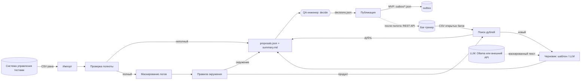

# Технологии и формат внедрения

```
Статус: на проверке
Дата: 2026-11-17
Автор: Claude (раздел 3 паспорта)
Основание: docs/TO-BE.md, QUESTIONS.md (№ 1, 5, 7)
Не проверено: доступ к API трекера и TMS, разрешение ИБ на внешнюю LLM — не подтверждены
```

## 1. Технологии по шагам TO BE

| Шаг TO BE | Технология | Зачем / альтернатива | Данные | Размещение | Способ интеграции | Условие / вопрос |
|---|---|---|---|---|---|---|
| 2. Импорт | Python 3.10+, модуль `csv` (стандартная библиотека) | Нет зависимостей, работает на ноутбуке QA. Альтернатива: pandas — избыточно | CSV рана (контракт — SPEC.md) | Ноутбук QA; позже — CI-задача | Файл | Формат экспорта TMS не подтверждён (№ 5) |
| 3. Полнота | Правила на Python | Прозрачно и проверяемо. Альтернатива: ИИ-оценка «понятен ли кейс» — после пилота | Поля кейса, наличие файлов | Там же | Внутренний модуль | Список обязательных полей — уточнить (№ 2, 9) |
| 4. Маскирование | Регулярные выражения | Быстро, без внешних сервисов. Альтернатива: Microsoft Presidio — точнее, но тяжелее | Логи | Там же | Внутренний модуль | Перечень чувствительных шаблонов согласовать с ИБ (№ 7) |
| 5. Окружение | Правила по шаблонам ошибок | Детерминированно. Альтернатива: классификация LLM | Маск. лог, факт | Там же | Внутренний модуль | Список признаков окружения расширять по реальным ранам |
| 6. Дубли | Сходство множеств основ слов (Жаккар) | Офлайн, без модели. Альтернативы: TF-IDF (scikit-learn), эмбеддинги (sentence-transformers / API) — точнее на перефразировках | Кейс, открытые баги | Там же | Внутренний модуль; список багов — CSV, позже API трекера | Порог 0,35 подобран на синтетике — перепроверить на реальных багах |
| 7. Черновик | Шаблон (по умолчанию) + LLM через OpenAI-совместимый API: локально Ollama (например, Qwen2.5 7B) или внешняя модель | Шаблон работает всегда; LLM улучшает формулировки. Альтернатива: только шаблон | Кейс + **маскированный** лог | Локальная LLM — на машине QA или сервере команды; внешняя — только с разрешения ИБ | HTTP JSON (`/v1/chat/completions`), тайм-аут, проверка схемы, откат на шаблон | Разрешение на внешнюю LLM (№ 7). Локальная LLM в MVP не проверена — план в MVP-CHECK |
| 8. Решение | CLI-команда `decide`, файл `decisions.json` | Минимум интерфейса. Альтернатива: веб-форма / бот в мессенджере — после пилота | Решения, роль, время | Ноутбук QA | Файл | Удобство для QA — проверить в пилоте |
| 9. Публикация | GitLab Issues REST API (`POST /projects/:id/issues`, `POST …/notes`); в MVP — файл outbox | Отдельный шаг с повторами и идемпотентностью. Альтернатива: Jira REST API | Подтверждённые черновики | Outbox — локально; API — CI с сервисной учёткой | HTTP, токен из переменной окружения | Трекер не подтверждён (№ 1); токен с правом только на создание задач |
| 10. Сводка | Markdown-файл | Читается везде, можно переслать в мессенджер | Итоги анализа | Локально | Файл | — |
| Хранение | Папка `out/<RUN-ID>/` (JSON + Markdown) | Без БД в MVP. Альтернатива: SQLite при росте | Предложения, решения, outbox | Локально, в .gitignore | Файлы | — |
| Ревью кода | Скилл `skills/code-review` + git diff; GitLab MR — через API | Раздел 5 | Diff | Локально / CI | git, GitLab API | Публикация замечаний — только по решению человека |

## 2. Схема компонентов



## 3. Формат внедрения

| Этап | Где работает | Кто запускает | Доступы |
|---|---|---|---|
| MVP (учебный) | Ноутбук QA, Python, синтетика | QA-инженер вручную | Нет доступа к рабочим системам |
| Пилот (30–60 дней) | Ноутбук QA или общий сервер; локальная LLM | QA-инженер после рана | Чтение экспорта TMS; outbox, публикацию переносит человек |
| Внедрение (90 дней) | CI-задача GitLab по завершении рана | Автоматически, решение — человек | Сервисная учётка трекера: только создание задач и комментариев |

## 4. Неподтверждённые доступы и решения

- Тип трекера и обязательные поля — № 1, 2.
- Формат экспорта TMS — № 5.
- Можно ли отправлять маскированные логи во внешнюю LLM — № 7. До ответа — только шаблон или локальная модель.
- Кто выдаёт сервисную учётку для публикации — новый вопрос № 13.
